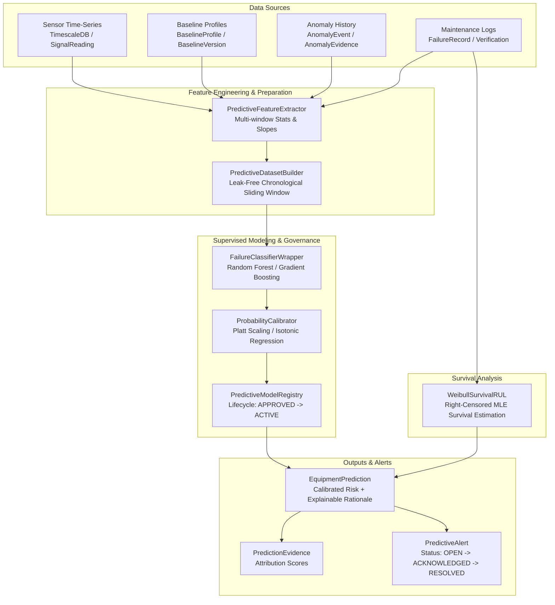

# PharmaPredict AI — Phase 6: Failure Prediction, Risk Estimation & Remaining Useful Life (RUL)

## 1. Executive Summary

Phase 6 elevates **PharmaPredict AI** from equipment condition monitoring and anomaly detection (Phase 5) to **predictive intelligence**, providing:
1. **Calibrated Multi-Horizon Failure Probability Forecasting** (24-hour, 7-day, 30-day horizons) evaluated with Brier score calibration metrics ($< 0.25$).
2. **Parametric Weibull Survival Modeling for Conditional Remaining Useful Life (RUL)** with right-censored observation intervals, conditional Mean Residual Life (MRL), and 90% confidence bounds $[RUL_{lower}, RUL_{upper}]$.
3. **Strict Fallback Governance**: Strictly returns `PREDICTION_UNAVAILABLE` or `RUL_UNAVAILABLE` when historical failure records are inadequate ($< 3$ verified positive cycles), eliminating fabricated risk estimates.
4. **Explainable Prediction Evidence**: Transparent attribution ranking contributing sensor features, baseline Z-score deviations, and anomaly context behind every prediction.
5. **Actionable Predictive Alerts**: Separate from Phase 5 anomaly alarms, with automatic deduplication, 12-hour cooldown suppression, and human-in-the-loop maintenance engineer review.

---

## 2. Architecture & Data Flow

---

## 3. Core Modules & Implementation Details

### 3.1 Failure Record Management & Catalog
- **Database Models**: `FailureMode`, `FailureRecord` in [`backend/app/models/prediction.py`](file:///c:/Users/Dell/OneDrive/Desktop/AI%20SOLUTION%20PROJECT/backend/app/models/prediction.py).
- **Verification States**:
  - `CONFIRMED`: Verified mechanical or electrical failure with confirmed root cause and corrective action.
  - `SUSPECTED`: Unverified symptom cluster requiring diagnostic follow-up.
  - `PREVENTIVE_MAINTENANCE` / `INSPECTION` / `PLANNED_SHUTDOWN`: Maintenance actions without functional failure, used for right-censoring in survival analysis.
  - `UNVERIFIED`: Freshly logged report awaiting reliability engineer verification.
- **Seeded Failure Modes**: Drive Motor Bearing Degradation (`FM_BEARING_DEGRADATION`), Main Motor Thermal Overload (`FM_MOTOR_OVERHEATING`), Pneumatic Pressure Loss (`FM_PNEUMATIC_PRESSURE_LOSS`), Vacuum Level Depletion (`FM_VACUUM_DEPLETION`), Dosing Auger Jamming (`FM_AUGER_MECHANICAL_JAM`).

### 3.2 Predictive Feature Engineering
- **File**: [`backend/app/ml_engine/prediction/predictive_features.py`](file:///c:/Users/Dell/OneDrive/Desktop/AI%20SOLUTION%20PROJECT/backend/app/ml_engine/prediction/predictive_features.py)
- Features extracted per signal over lookback window:
  - **Statistical**: `latest`, `mean`, `max`, `std`, `p95`, `p2p` (peak-to-peak).
  - **Trend Dynamics**: `slope_per_hour` (linear rate of change in signal units per hour).
  - **Baseline Deviation**: `baseline_z_score` ($|x_{latest} - \mu_{baseline}| / \sigma_{baseline}$) against approved baseline envelopes.
  - **Operating Context**: Total cumulative running hours up to observation cutoff.
  - **Anomaly Density**: Count of discrete anomalies detected in the preceding 24 hours.

### 3.3 Leak-Free Supervised Dataset Construction
- **File**: [`backend/app/ml_engine/prediction/dataset_builder.py`](file:///c:/Users/Dell/OneDrive/Desktop/AI%20SOLUTION%20PROJECT/backend/app/ml_engine/prediction/dataset_builder.py)
- **Zero-Leakage Guarantee**: Feature windows $[t_{cutoff} - W_{lookback}, t_{cutoff}]$ strictly precede the forecasting horizon $(t_{cutoff}, t_{cutoff} + H_{horizon}]$.
- **Temporal Splitting**: Train and validation sets are partitioned chronologically (earlier 75% for training, later 25% for validation and probability calibration) without random shuffle leakage.

### 3.4 Supervised Classification & Probability Calibration
- **File**: [`backend/app/ml_engine/prediction/failure_classifier.py`](file:///c:/Users/Dell/OneDrive/Desktop/AI%20SOLUTION%20PROJECT/backend/app/ml_engine/prediction/failure_classifier.py) & [`backend/app/ml_engine/prediction/probability_calibrator.py`](file:///c:/Users/Dell/OneDrive/Desktop/AI%20SOLUTION%20PROJECT/backend/app/ml_engine/prediction/probability_calibrator.py)
- **Algorithms Supported**: `RANDOM_FOREST` (balanced class weighting, max depth 6), `GRADIENT_BOOSTING`, `LOGISTIC_REGRESSION`.
- **Calibration Engine**: Implements Platt scaling (sigmoid) and Isotonic regression via scikit-learn `FrozenEstimator`.
- **Quality Gates**:
  - Requires minimum 3 verified positive failure events in historical dataset.
  - Evaluates Brier score: $BS = \frac{1}{N} \sum_{i=1}^N (p_i - y_i)^2$. Models with $BS < 0.25$ are certified as well-calibrated.

### 3.5 Parametric Weibull Remaining Useful Life (RUL)
- **File**: [`backend/app/ml_engine/prediction/rul_estimator.py`](file:///c:/Users/Dell/OneDrive/Desktop/AI%20SOLUTION%20PROJECT/backend/app/ml_engine/prediction/rul_estimator.py)
- **Formulation**:
  $$S(t) = \exp\left(-\left(\frac{t}{\lambda}\right)^k\right)$$
- **Conditional Survival**:
  $$S(u \mid t) = \frac{S(t + u)}{S(t)} = \exp\left(-\left(\frac{t + u}{\lambda}\right)^k + \left(\frac{t}{\lambda}\right)^k\right)$$
- **Conditional Mean Residual Life (MRL)**:
  $$MRL(t) = \int_0^\infty S(u \mid t) \, du$$
- Evaluated via numerical trapezoidal integration with 90% confidence bounds $[u_{90\%}, u_{10\%}]$.
- **Data Adequacy Gate**: If fewer than 3 verified failure events exist, RUL estimation returns `is_available=False` with transparent explanation rather than unverified arbitrary numbers.

### 3.6 Multi-Factor Eligibility Engine
- **File**: [`backend/app/ml_engine/prediction/eligibility_engine.py`](file:///c:/Users/Dell/OneDrive/Desktop/AI%20SOLUTION%20PROJECT/backend/app/ml_engine/prediction/eligibility_engine.py)
- Computes machine states:
  - `NOT_CONFIGURED`: Equipment has no active mapped telemetry signals.
  - `DATA_QUALITY_BLOCKED`: Telemetry degraded (`BAD`, `STALE`, `MISSING`); predictions withheld to prevent false alarms.
  - `INSUFFICIENT_DATA`: Verified failure events $< 3$ or telemetry span $< 24$ hours. Phase 5 Anomaly Detection remains active.
  - `TRAINING_ELIGIBLE`: Sufficient data and verified failures exist to train a machine-specific model.
  - `UNDER_VALIDATION`: Model trained and calibrated; awaiting reliability engineer validation.
  - `PREDICTION_READY`: Validated and approved model active for live risk inference.

---

## 4. REST API Endpoints

| Method | Endpoint | Description |
|---|---|---|
| `GET` | `/api/v1/failure-modes` | List standard and organization failure modes |
| `POST` | `/api/v1/failure-modes` | Create custom failure mode |
| `GET` | `/api/v1/equipment/<id>/failure-records` | List failure and maintenance records |
| `POST` | `/api/v1/equipment/<id>/failure-records` | Log new failure/maintenance record |
| `PATCH` | `/api/v1/failure-records/<id>/verify` | Engineer verification and root cause confirmation |
| `GET` | `/api/v1/equipment/<id>/prediction-eligibility` | Evaluate model readiness and data adequacy |
| `POST` | `/api/v1/equipment/<id>/predictive-models/train` | Train and calibrate supervised model |
| `GET` | `/api/v1/equipment/<id>/predictive-models` | List model families and versions |
| `POST` | `/api/v1/predictive-models/<id>/approve` | Approve validated model version |
| `POST` | `/api/v1/predictive-models/<id>/activate` | Activate approved model for live inference |
| `POST` | `/api/v1/equipment/<id>/predictions/evaluate` | Trigger on-demand risk & RUL evaluation |
| `GET` | `/api/v1/equipment/<id>/predictions` | Query latest and historical predictions |
| `GET` | `/api/v1/predictions/<id>` | Query prediction detail with feature evidence items |
| `GET` | `/api/v1/predictive-alerts` | List actionable predictive maintenance alerts |
| `POST` | `/api/v1/predictive-alerts/<id>/review` | Acknowledge, investigate, resolve, or dismiss alert |

---

## 5. Verification & Test Coverage

All 10 Phase 6 automated tests in [`backend/tests/test_phase6_prediction.py`](file:///c:/Users/Dell/OneDrive/Desktop/AI%20SOLUTION%20PROJECT/backend/tests/test_phase6_prediction.py) pass with 100% success rate:
- `test_failure_modes_catalog`: Standard catalog querying and custom mode creation with tenant isolation.
- `test_failure_records_lifecycle`: Unverified logging, root cause assignment, and engineer confirmation.
- `test_dataset_builder_temporal_split`: Zero-leakage chronological sliding window and temporal split.
- `test_insufficient_data_rejection`: Rejection of training attempts with $< 3$ positive failure events.
- `test_supervised_classifier_training_and_calibration`: Random Forest training, Platt/Isotonic calibration, Brier score ($< 0.25$), artifact persistence.
- `test_weibull_survival_rul`: Parametric Weibull survival MLE, right-censoring, conditional MRL, and unavailable fallback.
- `test_eligibility_engine`: Validation of state transitions (`INSUFFICIENT_DATA` $\rightarrow$ `TRAINING_ELIGIBLE`).
- `test_model_governance_lifecycle`: State machine enforcement (`UNDER_VALIDATION` $\rightarrow$ `APPROVED` $\rightarrow$ `ACTIVE`).
- `test_predictive_alert_workflow`: Alert creation on high risk, cooldown deduplication, and engineer review.
- `test_tenant_isolation`: Cross-tenant security across records, models, and predictions.

