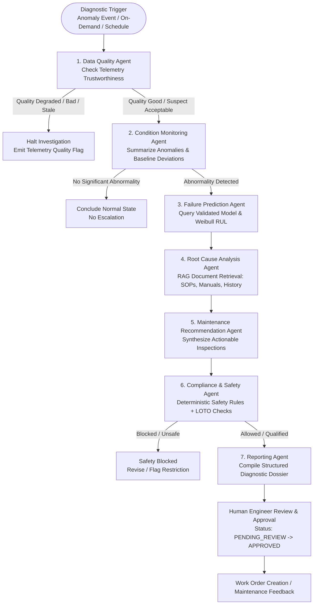

# PharmaPredict AI — Phase 7 Pre-Implementation Audit & Readiness Assessment

## 1. System Inventory & Foundation Review

| Module / System | Current Status | Integration Anchor for Phase 7 |
|---|---|---|
| **Phase 1: Landing Page & Backend** | Operational | Flask factory pattern, database extensions, CORS, configuration. |
| **Phase 2: Auth, RBAC & Multi-Tenancy** | Operational | Multi-tenancy isolation (`organization_id`), session decorators (`@login_required`), user roles. |
| **Phase 3: Universal Equipment Registry** | Operational | `Machine`, `MachineComponent`, categories, production areas, lines. |
| **Phase 4: Industrial Connectivity & Time-Series** | Operational | OPC UA async connector, tag discovery, signal mapping, `SignalReading` telemetry. |
| **Phase 5: Data Quality, Baselines & Anomaly Detection** | Operational & 100% Tested | `DataQualityService`, `OperatingStateClassifier`, `BaselineProfile`/`BaselineVersion`, `StatisticalAnomalyDetector`, `IsolationForestWrapper`, `AnomalyService`. |
| **Phase 6: Failure Prediction & RUL Framework** | Operational & 100% Tested | `FailureModeCatalog`, `FailureRecord` (maintenance logs), `ModelEligibilityEngine`, `FailureClassifierWrapper`, `WeibullSurvivalRUL`, `PredictionPipeline`, `PredictiveAlert`. |
| **AI Orchestration (Phase 7)** | Initializing | LangGraph 1.2.19, LangChain 1.4.7, LangSmith 0.14.16 installed in virtual environment. |

---

## 2. Phase 5 & Phase 6 Reuse Strategy

The AI Agents in Phase 7 must **never reinvent or duplicate analytical calculations**:
1. **Data Quality Agent**:
   - Reuses `DataQualityService.evaluate_machine_quality()` directly.
   - If quality is `BAD`, `STALE`, or `MISSING`, the agent halts diagnostic escalation and outputs a data-quality alert.
2. **Condition Monitoring Agent**:
   - Reuses `AnomalyService` and `BaselineProfile` to retrieve statistical Z-score deviations and multivariate Isolation Forest scores.
   - Preserves approved engineering thresholds.
3. **Failure Prediction Agent**:
   - Calls `ModelEligibilityEngine.evaluate_machine_eligibility()`.
   - If model status is `PREDICTION_READY`, extracts calibrated probabilities and parametric Weibull conditional RUL from `PredictionPipeline`.
   - If eligibility is not met, returns `PREDICTION_UNAVAILABLE` or `RUL_UNAVAILABLE` with clear explanation.
   - **Strict Rule**: LLMs never invent, hallucinate, or estimate failure probabilities or RUL numbers.
4. **Maintenance History**:
   - Reads historical `FailureRecord` objects (confirmed/suspected failures, root causes, maintenance actions, and downtime) as verified historical context.

---

## 3. LangGraph Architecture & 7-Agent Topology

---

## 4. Multi-Tenant RAG & Vector Knowledge Storage

- **pgvector & Semantic Fallback**:
  - Implements document chunking, metadata extraction (machine category, manufacturer, model, component type), and dense vector embeddings.
  - Enforces strict tenant partitioning: `organization_id` filter is applied deterministically outside the LLM.
  - Prevents cross-tenant document leakage and maintains immutable citation references (document title, version, page, section).
- **Replaceable Provider Abstraction**:
  - Primary provider: Configurable OpenAI/Gemini/Anthropic embeddings & LLM.
  - Deterministic Offline Fallback: If no external LLM API key is provided, the RAG engine uses BM25/keyword indexing and deterministic diagnostic rules, ensuring zero downtime and offline pharmaceutical air-gap compatibility.
  - Zero factory telemetry or proprietary documentation is sent to third-party endpoints without explicit tenant authorization.

---

## 5. Security & Prompt Injection Mitigation

1. **Untrusted Input Boundaries**:
   - Manuals, troubleshooting guides, maintenance technician notes, and user prompts are treated as untrusted text.
2. **Deterministic Safety Rules First**:
   - Safety, Lockout/Tagout (LOTO), electrical isolation, and GMP change-control restrictions are executed by deterministic Python logic in the Compliance Agent. LLM outputs cannot override or bypass these checks.
3. **Read-Only Industrial Architecture**:
   - No agent has tools or interfaces capable of writing to OPC UA nodes, stopping machines, or triggering physical actuators.
4. **Strict Schema Validation**:
   - All agent outputs adhere to Pydantic schemas before state propagation.

---

## 6. Audit Sign-Off

- **Previous Phases Status**: Phase 1–6 complete and fully tested (18/18 tests passing).
- **Dependencies**: `langgraph`, `langchain`, `langsmith`, `pydantic` installed and verified.
- **Backend Health**: Flask service healthy at `http://127.0.0.1:5000`.
- **Frontend Health**: Next.js service healthy at `http://localhost:3000`.
- **Readiness**: Fully prepared for Phase 7 implementation.

